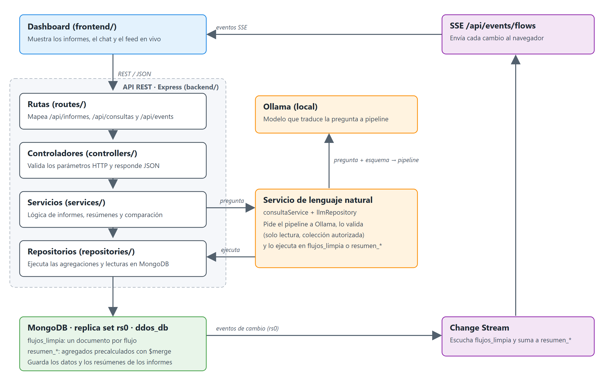
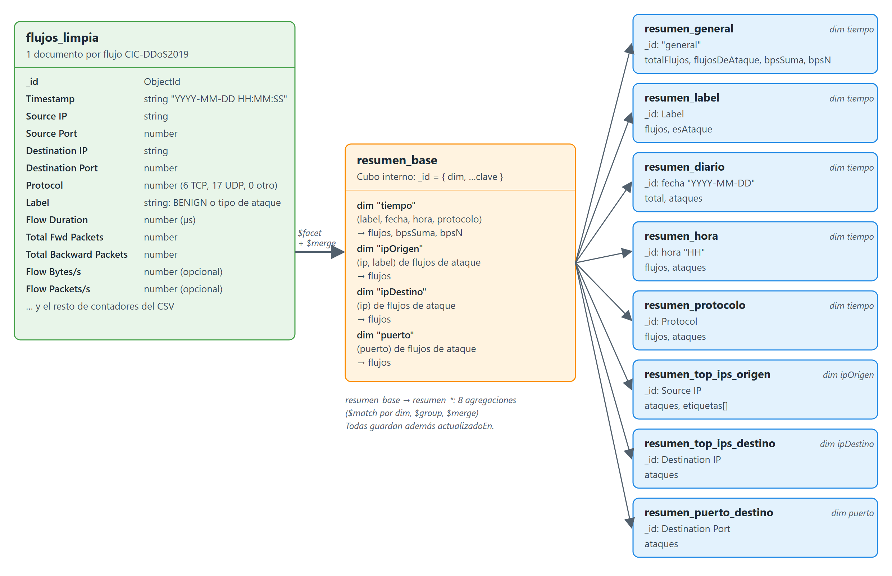

# Parcial 3: analítica de flujos DDoS

Este documento contrasta la implementación con el PDF **Proyecto Parcial — Dashboard para análisis de grandes volúmenes de datos**. Las cifras de `db.stats` se tomaron de la instancia local el 8 de noviembre de 2026 y las de los informes se leyeron de las colecciones `resumen_*` el 11 de noviembre de 2026; deben volver a generarse antes de la sustentación.

## Caso de estudio

- **Problema:** identificar patrones de tráfico malicioso y posibles ataques de denegación de servicio en los flujos CIC-DDoS2019.
- **Usuarios:** analistas de seguridad, operadores de red y responsables de infraestructura.
- **Información:** marca temporal, IP y puerto de origen y destino, protocolo, duración, contadores y tasas de paquetes/bytes, banderas TCP y etiqueta del flujo.
- **Decisiones apoyadas:** priorizar tipos de ataque, orígenes, destinos, servicios y horarios; observar la variación de actividad y decidir qué reglas, servicios o activos requieren investigación.
- **Valor del volumen:** permite explorar muchos flujos en MongoDB sin descargar la colección completa ni calcular agregados en el navegador o en memoria del backend.
- **Fuente del dataset:** [CIC-DDoS2019, Canadian Institute for Cybersecurity](https://www.unb.ca/cic/datasets/ddos-2019.html).

## Cobertura de informes

Los informes 1–8 leen las colecciones `resumen_*`, que se calculan sobre los 70 427 637 flujos de `flujos_limpia` (no sobre una muestra) y se alimentan con `$merge` (`npm run db:resumenes` y el Change Stream). Cada endpoint ejecuta una agregación sobre `resumen_general` con `$lookup` a los demás resúmenes, de modo que ordenar y limitar ocurre en MongoDB. Los informes 9–11 pasan por el mecanismo de lenguaje natural; el 12 es el tiempo real y el 13 compara dos periodos.

| No. | Informe | Pregunta | Consulta | Visualización | Interpretación |
|---|---|---|---|---|---|
| 1 | Indicadores generales | ¿Cuántos flujos y ataques hay y qué porcentaje representan? | `resumen_general`: `$match` + `$lookup` a `resumen_label` + `$project` (porcentaje, tipo más frecuente) | Tarjetas de indicadores | 70 313 809 de 70 427 637 flujos son ataques (99,84 %); solo 113 828 son `BENIGN`. El tipo más frecuente es `TFTP`. |
| 2 | Tendencia | ¿Cómo cambia el volumen por día y cuántos flujos son ataques? | `resumen_diario`: `$sort`, `$limit`, `$project` (vía `$lookup`) | Barras agrupadas por día | El dataset tiene dos días: 2018-11-03 con 20 364 525 flujos (20 307 560 ataques) y 2018-12-01 con 50 063 112 (50 006 249 ataques). |
| 3 | Orígenes | ¿Qué IP de origen concentra más flujos maliciosos? | `resumen_top_ips_origen`: `$sort` por `ataques`, `$limit 5` | Ranking con barras | **172.16.0.5 concentra 70 289 460 ataques, el 99,97 % del total**; le siguen 192.168.50.1 (16 270) y 192.168.50.4 (8 079). |
| 4 | Tipos de ataque | ¿Qué amenazas concentran los flujos maliciosos? | `resumen_label`: `$match` excluye `BENIGN`, `$sort` por `flujos` | Ranking | `TFTP` (20 082 580), `Syn` (6 473 789) y `MSSQL` (5 787 453) encabezan las 18 etiquetas de ataque; `WebDDoS` es la más rara (439). |
| 5 | Destinos | ¿Qué activos reciben más tráfico malicioso? | `resumen_top_ips_destino`: `$sort` por `ataques`, `$limit` | Ranking | Solo tres IP reciben ataques: 192.168.50.1 (49 989 979), 192.168.50.4 (20 299 481) y 172.16.0.5 (24 349). |
| 6 | Protocolos | ¿Qué protocolos transportan más flujos y ataques? | `resumen_protocolo`: `$sort` por `flujos`, `$limit` | Ranking | UDP (17) lleva 63 396 525 flujos (63 358 914 ataques) y TCP (6) 7 027 114 (6 953 588); el protocolo 0 solo 3 998. |
| 7 | Servicios | ¿Qué puertos destino deben recibir atención prioritaria? | `resumen_puerto_destino`: `$sort` por `ataques`, `$limit` | Ranking | Los ataques se reparten entre 65 535 puertos; el más afectado, el 22, suma 6 955, seguido del 80 (6 264) y el 137 (2 552). |
| 8 | Horarios | ¿En qué horas se concentra el tráfico malicioso? | `resumen_hora`: `$sort` por hora | Ranking por hora | La actividad se concentra entre las 10 y las 13 h; el pico es a las 13 h con 23 549 568 ataques. |
| 9 | Lenguaje natural | ¿Cuáles son los tipos de ataque más frecuentes? | Ollama genera el pipeline; el backend lo valida y lo ejecuta en `resumen_label` | Conversación con pipeline y resultado | Devuelve el mismo ranking del informe 4 (`TFTP`: 20 082 580). |
| 10 | Lenguaje natural | ¿Cuántos flujos son benignos y cuántos son ataques? | `resumen_label`: `$group` por `esAtaque`, `$sort` | Conversación | `Ataque`: 70 313 809; `BENIGN`: 113 828, igual que el informe 1. |
| 11 | Lenguaje natural | ¿Qué IP de origen tiene más ataques? | `resumen_top_ips_origen`: `$sort`, `$limit 1` | Conversación | 172.16.0.5 con 70 289 460 ataques, igual que el informe 3. |
| 12 | Tiempo real | ¿Qué inserciones, actualizaciones o eliminaciones ocurren? | Change Stream sobre `flujos_limpia` → suma a `resumen_*` con `$merge` → SSE `/api/events/flows` | Feed de eventos y recarga automática de los informes 1–8 | En la prueba, insertar, modificar y eliminar un flujo se reflejó en los resúmenes y en el feed, y el estado final quedó idéntico al inicial. |
| 13 | Comparación | ¿Cómo cambian el volumen y los tipos de ataque entre 2018-12-01 y 2018-11-03? | `resumen_base` (dim `tiempo`): `$match`, `$set`, `$project`, `$unwind`, dos `$group`, `$project` con top 5 de `Label` | Barras agrupadas por periodo | 2018-12-01 tiene 50 063 112 flujos (99,89 % ataques, encabezado por `TFTP`) y 2018-11-03 20 364 525 (99,72 %, encabezado por `MSSQL`). |

La tabla «Flujos más recientes» del dashboard lee directamente `flujos_limpia` (`find` ordenado por `Timestamp` descendente con `limit 10`, usando `idxtimestamp`).

## Lenguaje natural

Ollama recibe solo la pregunta y el esquema; el backend valida etapas, campos y colección autorizada (`flujos_limpia` o una `resumen_*`) y ejecuta el pipeline de solo lectura.
Las cinco preguntas de prueba respondieron HTTP 200 y coincidieron exactamente con las colecciones resumen.
Pipelines, tiempos y resultados: [evidencia-lenguaje-natural.md](evidencia-lenguaje-natural.md).

## Tiempo real

El Change Stream suma cada inserción a los resúmenes y, con las pre-images, resta actualizaciones y borrados; el SSE avisa al dashboard, que recarga los informes.
Evidencia de insertar, modificar y eliminar: [evidencia-tiempo-real.md](evidencia-tiempo-real.md).

## Base de datos y volumen

La instancia local consultada contiene **70 427 637 documentos** en `ddos_db.flujos_limpia`, cargados desde los 18 CSV limpios (sin columna de índice, nombres sin espacios, Infinity/NaN omitidos, `Label` normalizado y `Timestamp` como texto `YYYY-MM-DD HH:MM:SS`).

| Métrica de `db.stats(1024*1024*1024)` | Valor observado |
|---|---:|
| `dataSize` (datos lógicos, sin índices) | 139.07 GiB |
| `storageSize` (espacio de colección asignado en disco) | 17.28 GiB |
| `indexSize` (índices, separado de los datos) | 3.46 GiB |
| `count` | 70 427 637 |

El ejemplo de medición del PDF usa `db.stats(1024*1024*1024)` y solicita no sumar índices como si fueran datos. Con ese indicador, `dataSize` supera 20 GiB. La compresión de WiredTiger explica que el espacio asignado a la colección en disco sea menor; **si el docente interpreta el requisito como 20 GiB físicos en `storageSize`, hay que confirmar ese criterio y ampliar el dataset de forma legítima, no duplicando registros artificialmente**.

Reproducir la medición:

```javascript
const stats = db.getSiblingDB("ddos_db").stats(1024 * 1024 * 1024);
printjson({
  dataSizeGiB: stats.dataSize,
  storageSizeGiB: stats.storageSize,
  indexSizeGiB: stats.indexSize,
  collections: stats.collections
});
printjson(db.getSiblingDB("ddos_db").flujos_limpia.stats(1024 * 1024 * 1024));
```

Los agregados de informes se ejecutan en MongoDB. El backend no descarga la colección completa para filtrar o agrupar: los informes leen las colecciones `resumen_*`, que contienen cifras exactas del dataset completo.

## Índices y optimización

`flujos_limpia` tiene cinco índices (`idxtimestamp`, `idx_label`, `idx_source_ip`, `idx_protocol` e `idx_label_timestamp`), creados con `npm run db:indexes`.
Medidas con `explain("executionStats")` frente a un COLLSCAN forzado, las tres consultas del benchmark (IP de origen, `Label` + rango de `Timestamp` y rango de `Timestamp`) pasan de examinar 70 427 637 documentos a examinar solo los que devuelven.
La mediana baja de entre 133 288 y 210 057 ms con COLLSCAN a entre 0 y 1 ms con índice; tabla completa y justificación en [optimizacion-indices.md](optimizacion-indices.md).

## Arquitectura



- `frontend/`: presentación, gráficos/rankings, formularios y consumidor SSE.
- `backend/routes/`: mapea endpoints y controladores.
- `backend/controllers/`: valida parámetros HTTP, entrega JSON y maneja errores.
- `backend/services/`: lógica de aplicación, integración Ollama, resúmenes y difusión de eventos.
- `backend/repositories/`: agregaciones y consultas MongoDB.
- `backend/config/`: conexión verificada a la base y colección.
- `backend/models/`: serialización de documentos para la API.

## Modelo de datos



`flujos_limpia` es la colección documental de origen: cada documento es un flujo CIC-DDoS2019 y `Label` distingue `BENIGN` de las etiquetas de ataque. Los nombres con espacios, como `Source IP` y `Destination Port`, se conservan tal como existen en el dataset.

Las colecciones `resumen_*` se derivan en dos pasos, ambos con `$merge`:

1. Un único recorrido de `flujos_limpia` con `$facet` escribe `resumen_base`, un cubo interno con cuatro dimensiones: `tiempo` (Label, fecha, hora, protocolo → flujos y suma de `Flow Bytes/s`), `ipOrigen` (IP y Label de ataques), `ipDestino` y `puerto` (destinos de ataques).
2. Ocho agregaciones sobre `resumen_base` generan las colecciones que consultan la API y el lenguaje natural:

| Colección | `_id` | Contenido |
|---|---|---|
| `resumen_general` | `"general"` | Total de flujos, flujos de ataque y suma/cantidad de `Flow Bytes/s` |
| `resumen_label` | `Label` | Flujos por etiqueta y si es ataque |
| `resumen_diario` | fecha | Flujos y ataques por día |
| `resumen_hora` | hora | Flujos y ataques por hora del día |
| `resumen_protocolo` | `Protocol` | Flujos y ataques por protocolo |
| `resumen_top_ips_origen` | IP de origen | Ataques y etiquetas de ataque de cada IP |
| `resumen_top_ips_destino` | IP de destino | Ataques recibidos por cada IP |
| `resumen_puerto_destino` | puerto destino | Ataques por puerto |

Como todas las cifras son sumas, el Change Stream mantiene los resúmenes al día aplicando los mismos pipelines a los flujos nuevos (modo suma de `$merge`) sin recorrer de nuevo los 70 M de documentos. `resumen_estado` guarda la generación y el estado del recálculo.

## Instalación, ejecución y operación

**Código fuente:** [ZZsantim/parcial_bd2](https://github.com/ZZsantim/parcial_bd2). Instrucciones de instalación y ejecución en el [README](../../README.md).

**Nota de operación:** la API requiere que MongoDB se ejecute como replica set (`rs0`), porque los Change Streams no funcionan en una instancia independiente. Además, `flujos_limpia` tiene activadas las pre-images del Change Stream con caducidad de 3600 s (`npm run db:indexes`), necesarias para restar de los resúmenes las actualizaciones y los borrados.

## Pendientes externos a la implementación

- Nombres de los integrantes.
- Enlace de GitHub en la entrega.
- Métrica de los 20 GB: confirmar con el docente si se valida con `dataSize` (139.07 GiB) o con `storageSize` (17.28 GiB).
- Capturas del dashboard, de `db.stats`, de `npm run db:explain`, de las preguntas en lenguaje natural y del tiempo real.
