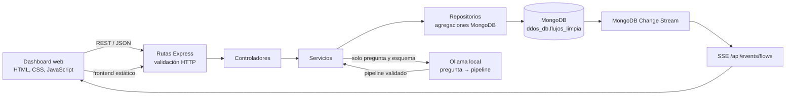
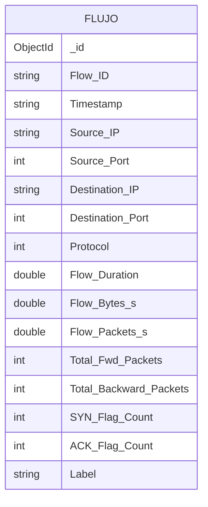

# Parcial 3: analítica de flujos DDoS

Este documento contrasta la implementación con el PDF **Proyecto Parcial — Dashboard para análisis de grandes volúmenes de datos** y con `fin.md`. `fin.md` enfatiza el flujo conversacional de consultas naturales, la validación del pipeline de solo lectura y la integración del frontend con MongoDB Change Streams, sin Firebase; esas tres partes están integradas en el dashboard. Las mediciones de MongoDB se tomaron de la instancia local el 8 de noviembre de 2026; deben volver a generarse antes de la sustentación.

## Caso de estudio

- **Problema:** identificar patrones de tráfico malicioso y posibles ataques de denegación de servicio en los flujos CIC-DDoS2019.
- **Usuarios:** analistas de seguridad, operadores de red y responsables de infraestructura.
- **Información:** marca temporal, IP y puerto de origen y destino, protocolo, duración, contadores y tasas de paquetes/bytes, banderas TCP y etiqueta del flujo.
- **Decisiones apoyadas:** priorizar tipos de ataque, orígenes, destinos, servicios y horarios; observar la variación de actividad y decidir qué reglas, servicios o activos requieren investigación.
- **Valor del volumen:** permite explorar muchos flujos en MongoDB sin descargar la colección completa ni calcular agregados en el navegador o en memoria del backend.
- **Fuente del dataset:** [CIC-DDoS2019, Canadian Institute for Cybersecurity](https://www.unb.ca/cic/datasets/ddos-2019.html).

## Cobertura de informes

Cada informe agrega, filtra o limita resultados en MongoDB. Los informes 1–8 se calculan sobre los 10 000 flujos más recientes, ordenados usando el índice de `Timestamp`. Los informes 9–11 son preguntas distintas que pasan por el mecanismo de lenguaje natural; el usuario puede variar la pregunta.

| No. | Informe y pregunta que responde | Consulta y visualización | Utilidad |
|---|---|---|---|
| 1 | Indicadores generales: ¿cuántos flujos y ataques hay y qué porcentaje representan? | Agregación `$facet`/`$group`; tarjetas de indicadores | Dimensionar y priorizar el análisis |
| 2 | Evolución diaria: ¿cómo cambia el volumen y cuántos flujos son ataques? | `$group` por fecha y `$sort`; gráfico de barras | Detectar cambios temporales |
| 3 | Orígenes de ataque: ¿qué IP de origen concentra más flujos maliciosos? | `$match`, `$group`, `$sort`, `$limit`; ranking con barras | Investigar orígenes dominantes |
| 4 | Tipos de ataque: ¿qué etiquetas maliciosas son más frecuentes? | `$match` excluye `BENIGN`, `$group`, `$sort`; ranking | Priorizar mitigaciones por amenaza |
| 5 | Destinos atacados: ¿qué IP recibe más flujos maliciosos? | `$match`, `$group`, `$sort`, `$limit`; ranking | Identificar activos expuestos |
| 6 | Protocolos: ¿qué protocolos concentran flujos y ataques? | `$group` por protocolo; ranking | Priorizar inspección de protocolos |
| 7 | Puertos destino: ¿qué servicios reciben más ataques? | `$match`, `$group`, `$sort`, `$limit`; ranking | Priorizar servicios y reglas de red |
| 8 | Horas críticas: ¿en qué horas se concentra la actividad maliciosa? | `$group` por hora; ranking | Apoyar planificación de monitoreo |
| 9 | Lenguaje natural: ¿cuáles son los tipos de ataque más frecuentes? | Ollama genera pipeline; MongoDB devuelve resultados; conversación muestra pipeline y resultado | Explorar datos sin escribir consultas |
| 10 | Lenguaje natural: ¿cuántos flujos son benignos y cuántos son ataques? | Pregunta independiente ejecutada como agregación MongoDB | Comparar tráfico benigno y malicioso |
| 11 | Lenguaje natural: ¿qué IP de origen tiene más ataques? | Pregunta independiente ejecutada como agregación MongoDB | Consultar un indicador específico |
| 12 | Cambios en vivo: ¿qué inserciones, actualizaciones, reemplazos o eliminaciones ocurren? | Change Stream → SSE → feed visible y recarga automática de los informes | Observar cambios sin recargar la página |

Los informes 1, 2 y 3 se vuelven a consultar automáticamente al recibir un evento; también se actualizan los informes 4–8. El informe 12 presenta los eventos recibidos. Se requieren MongoDB con replica set o clúster compatible y conexión del navegador a `/api/events/flows`.

Las tres preguntas naturales de ejemplo están disponibles como sugerencias en el dashboard. La respuesta muestra explicación, pipeline generado, cantidad de resultados y salida de MongoDB. El backend valida etapas, campos y operadores permitidos, limita la consulta a 10 000 flujos y 100 resultados, y rechaza etapas de escritura.

Ejecución comprobada con el modelo local `qwen2.5:3b` sobre la colección anterior `ddos_db.flujos` (antes de la limpieza; los filtros de `BENIGN` ahora usan solo el valor exacto `"BENIGN"`):

| Pregunta | Resultado real |
|---|---|
| ¿Cuáles son los tipos de ataque más frecuentes? | `TFTP: 2726` |
| ¿Cuántos flujos son benignos y cuántos son ataques? | `BENIGN: 7274`; `Ataque: 2726` |
| ¿Qué IP de origen tiene más ataques? | `172.16.0.5: 1863`; `192.168.50.1: 863` |

En las tres respuestas, la API devolvió el pipeline que ejecutó y los resultados de la agregación. Para la comparación benigno/ataque se aplica una agrupación defensiva por las dos clases, porque se detectó y corrigió que el modelo podía devolver una consulta que excluyera `BENIGN`.

Pipelines y resultados registrados en la prueba local:

1. **Tipos de ataque**

   ```json
   [
     {"$match":{"$and":[{"Label":{"$nin":["BENIGN","Benign","BENIGN "]}},{"Label":{"$ne":"BENIGN"}}]}},
     {"$group":{"_id":"$Label","cantidad":{"$sum":1}}},
     {"$sort":{"cantidad":-1}}
   ]
   ```

   Resultado: `[{"_id":"TFTP","cantidad":2726}]`.

2. **Benignos frente a ataques**

   ```json
   [
     {"$group":{"_id":{"$cond":[{"$in":["$Label",["BENIGN","Benign","BENIGN "]]},"BENIGN","Ataque"]},"flujos":{"$sum":1}}},
     {"$sort":{"_id":1}}
   ]
   ```

   Resultado: `[{"_id":"Ataque","flujos":2726},{"_id":"BENIGN","flujos":7274}]`.

3. **IP de origen con más ataques**

   ```json
   [
     {"$match":{"$and":[{"Label":{"$nin":["BENIGN","Benign","BENIGN "]}},{"Label":{"$ne":"BENIGN"}}]}},
     {"$group":{"_id":"$Source IP","cantidad":{"$sum":1}}},
     {"$sort":{"cantidad":-1}}
   ]
   ```

   Resultado: `[{"_id":"172.16.0.5","cantidad":1863},{"_id":"192.168.50.1","cantidad":863}]`.

## Base de datos y volumen

La instancia local consultada contiene **70 427 637 documentos** en `ddos_db.flujos_limpia`, cargados desde los 18 CSV limpios (sin columna de índice, nombres sin espacios, Infinity/NaN omitidos, `Label` normalizado y `Timestamp` como texto `YYYY-MM-DD HH:MM:SS`).

| Métrica de `db.stats(1024*1024*1024)` | Valor observado |
|---|---:|
| `dataSize` (datos lógicos, sin índices) | 139.07 GiB |
| `storageSize` (espacio de colección asignado en disco) | 17.28 GiB |
| `indexSize` (índices, separado de los datos) | 3.46 GiB |
| `count` | 70 427 637 |

El ejemplo de medición del PDF usa `db.stats(1024*1024*1024)` y solicita no sumar índices como si fueran datos. Con ese indicador, `dataSize` supera 20 GiB. La compresión de WiredTiger explica que el espacio asignado a la colección en disco sea menor; **si el docente interpreta el requisito como 20 GiB físicos en `storageSize`, hay que confirmar ese criterio y ampliar el dataset de forma legítima, no duplicando registros artificialmente**.

Reproducir la medición:

```javascript
const stats = db.getSiblingDB("ddos_db").stats(1024 * 1024 * 1024);
printjson({
  dataSizeGiB: stats.dataSize,
  storageSizeGiB: stats.storageSize,
  indexSizeGiB: stats.indexSize,
  collections: stats.collections
});
printjson(db.getSiblingDB("ddos_db").flujos_limpia.stats(1024 * 1024 * 1024));
```

Los agregados de informes se ejecutan en MongoDB. El backend no descarga la colección completa para filtrar o agrupar. El resumen informa el conteo estimado de la colección y la cantidad analizada en la muestra; no presenta la estimación como un conteo exacto.

## Índices y optimización

Índices verificados en la colección:

| Índice | Claves | Propósito |
|---|---|---|
| `idxtimestamp` | `{ Timestamp: 1 }` | Ordenar/limitar la muestra reciente y recuperar los flujos recientes |
| `idx_label` | `{ Label: 1 }` | Filtrar etiquetas en consultas de clasificación |
| `idx_source_ip` | `{ "Source IP": 1 }` | Búsquedas y filtros por IP de origen |
| `idx_protocol` | `{ Protocol: 1 }` | Búsquedas y filtros por protocolo |
| `idx_label_timestamp` | `{ Label: 1, Timestamp: -1 }` | Consultas por etiqueta y periodo |

`npm run db:indexes` verifica/crea estos índices de forma idempotente. `npm run db:explain` genera planes `executionStats` para una consulta limitada con índice, la misma consulta con `COLLSCAN` forzado y la selección de los 10 000 flujos recientes. El baseline `COLLSCAN` se limita a 50 resultados; no se elimina ningún índice ni se modifica la colección.

Los pipelines de los informes parten por orden/limitación temporal, por lo que `idxtimestamp` es el índice principal de esa muestra. Los otros índices favorecen consultas filtradas por sus campos; no se afirma que cada índice se use en cada pipeline.

Resultado de tres ejecuciones locales de `npm run db:explain` sobre `ddos_db.flujos_limpia`:

| Consulta | Plan | `executionTimeMillis` | `totalDocsExamined` | `totalKeysExamined` | `nReturned` |
|---|---|---:|---:|---:|---:|
| `Label: BENIGN`, límite 50 | `IXSCAN` (`idx_label`) | 1 | 50 | 50 | 50 |
| Misma consulta, baseline forzado | `COLLSCAN` | 0 | 50 | 0 | 50 |
| Orden/selección de 10 000 por `Timestamp` | `IXSCAN` (`idxtimestamp`) | 46–73 | 0 | 10 000 | 10 000 |

El filtro de etiqueta devolvió 50 documentos examinando 50 claves. En `flujos_limpia` el baseline forzado también examina solo 50 documentos, porque el primer archivo importado (Portmap) empieza con flujos `BENIGN` y el `COLLSCAN` los encuentra de inmediato; con `limit 50` esta comparación no distingue ambos planes y no debe presentarse como mejora temporal. La consulta de muestra sí verifica el uso del índice temporal y el acceso cubierto (`totalDocsExamined: 0`). Ejecutar de nuevo el comando antes de presentar los resultados, preferiblemente en varias corridas controladas.

La demostración local del Change Stream insertó, actualizó y eliminó un documento temporal con identificador único. Los tres eventos aparecieron en el navegador; los informes se refrescaron y el documento de prueba se eliminó al terminar.

## Arquitectura



- `frontend/`: presentación, gráficos/rankings, formularios y consumidor SSE.
- `backend/routes/`: mapea endpoints y controladores.
- `backend/controllers/`: valida parámetros HTTP, entrega JSON y maneja errores.
- `backend/services/`: lógica de aplicación, integración Ollama y difusión de eventos.
- `backend/repositories/`: agregaciones y consultas MongoDB.
- `backend/config/`: conexión verificada a la base y colección.
- `backend/models/`: serialización de documentos para la API.

## Modelo de datos observado



La colección es documental y cada documento representa un flujo CIC-DDoS2019. `Label` distingue `BENIGN` de las etiquetas de ataques. Los nombres con espacios, como `Source IP` y `Destination Port`, se conservan tal como existen en el dataset.

## Instalación, ejecución y validación

**Código fuente:** [ZZsantim/parcial_bd2](https://github.com/ZZsantim/parcial_bd2).

Desde `api_ddos_dashboard/`:

```bash
npm install
npm test
npm run db:indexes
npm run db:explain
npm start
```

Configurar `backend/.env` con `MONGO_URI`, `DB_NAME=ddos_db`, `DB_COLLECTION=flujos_limpia`, `PORT` y la configuración local de Ollama. Abrir `http://localhost:3000` (o el puerto configurado). MongoDB local usa `127.0.0.1:27017` y el replica set `rs0`.

El modelo por defecto es `qwen3.5:9b`, el modelo de chat instalado en el Ollama local (`kimi-k2.5` no está instalado). `backend/.env.example` lo deja configurado; la evidencia de las preguntas está en `docs/evidencia-lenguaje-natural.md`.

## Pendientes externos a la implementación

- Confirmar con el docente que el umbral de 20 GiB se valida mediante `dataSize` (la métrica recomendada en el PDF); `storageSize` observado es 17.90 GiB.
- Registrar los nombres de los integrantes y el enlace del repositorio GitHub en la entrega; esa información no está en el código local.
- Tomar capturas/salida de terminal de las métricas de almacenamiento, `npm run db:explain`, tres preguntas naturales y una inserción/actualización/eliminación real durante la sustentación. Los datos de `db.stats` y `executionStats` cambian según el estado del servicio.
- Todos los integrantes deben preparar la explicación individual del caso, las agregaciones, los índices y la arquitectura, como exige la sustentación.
